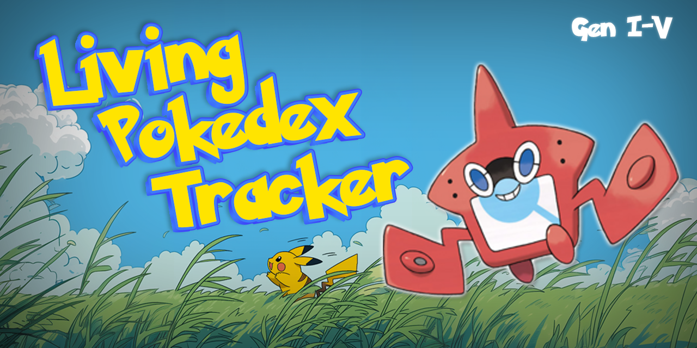
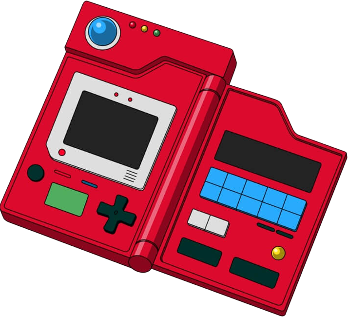

<h1 align="left">
  Pokémon Living Dex Tracker
  
</h1>

**Gotta catch 'em all. And keep one of each.**

Pokémon Living Dex Tracker is a free, fan-made checklist and acquisition guide for building a **Living Pokédex** across **20 Pokémon games from Generations I–V**. Instead of simply registering each Pokémon in your Pokédex, a Living Dex means keeping a copy of every Pokémon, including every stage of an evolution line.

The tracker helps you figure out **what to catch, where to find it, how to obtain it, and what you still need** without juggling multiple guides and spreadsheets.

  ✨
  
  ✨

## Features

- **20 game-specific Living Dex checklists:** Track progress separately for each supported game.
- **Where to find each Pokémon:** Browse locations, encounter methods, levels, encounter odds, and alternate options where available.
- **Acquisition instructions:** See when a Pokémon needs to be caught, evolved, bred, received as a gift, traded, or transferred from another game.
- **Smart copy counts:** Know how many copies to collect so you can evolve or breed Pokémon without losing an earlier stage from your Living Dex.
- **Search and filters:** Search by Pokémon, Pokédex number, route, or game. Filter by region and acquisition method, or hide Pokémon you've already collected.
- **Visual progress tracking:** Mark collected Pokémon with an animated Poké Ball and watch your completion bar fill up.
- **Game-specific sprites and themes:** Enjoy Pokémon sprites and colors inspired by the game you're tracking.
- **Personalize your view:** Favorite games for easier access, switch between light and dark modes, and toggle catch sounds.
- **Mobile-friendly:** Use the tracker on your phone, tablet, or computer.

## Supported games

| Generation | Games |
| --- | --- |
| **I** | Red, Blue, Yellow |
| **II** | Gold, Silver, Crystal |
| **III** | Ruby, Sapphire, Emerald, FireRed, LeafGreen |
| **IV** | Diamond, Pearl, Platinum, HeartGold, SoulSilver |
| **V** | Black, White, Black 2, White 2 |

## How it works

1. **Choose your game.** Each title has its own list and progress counter.
2. **Find your next Pokémon.** Search, browse the Pokédex, or filter to see only the entries you need.
3. **Check how to obtain it.** Each entry provides an acquisition method and relevant details, including other-game requirements where applicable.
4. **Plan your evolution lines.** Copy counts indicate when you'll need additional Pokémon to keep each evolutionary stage in your collection.
5. **Click the Poké Ball.** Mark an entry once that Pokémon is safely in your boxes. Your progress updates immediately.

**Your progress is saved automatically in your browser.** On an independently hosted version, it is local to that browser and device. Clearing site data or using another device may mean your saved checklist isn't available there.

## A few things to know

Building a Living Dex in older Pokémon games can require more than one cartridge or save file. Depending on the game and Pokémon, you may need trading, breeding, limited gifts, special encounters, events, or transfers between generations. The tracker highlights these requirements where its data supports them.

The acquisition guide is designed to prioritize useful routes, but encounter availability and odds can depend on conditions in the selected game. Check the in-app game notes and **Sources** menu for additional details. If something looks wrong or incomplete, please report it.

## Sources and credits

Location and acquisition information is drawn from game-data projects and community references, including:

- [pret game disassembly projects](https://github.com/pret)
- [PokéAPI](https://pokeapi.co/)
- [Serebii](https://www.serebii.net/)
- [PokéAPI sprite repository](https://github.com/PokeAPI/sprites) for externally hosted Pokémon sprites

The tracker also includes more detailed, game-specific source links in its **Sources** menu.

## Feedback and contributions

Found an incorrect encounter location, missing acquisition method, confusing explanation, or bug? Open a GitHub issue. For data corrections, please include the **game, Pokémon, what appears incorrect, and a source** if possible.

Suggestions to improve usability and accessibility are welcome too. This is a community resource, and accurate feedback helps make it better for everyone.

## Free, unofficial fan project

Pokémon Living Dex Tracker is a **noncommercial fan-made community project**. It is not affiliated with, sponsored by, or endorsed by Nintendo, Game Freak, or The Pokémon Company.

Pokémon names, characters, artwork, sprites, and related trademarks belong to their respective rights holders. Their inclusion here is for reference and identification purposes and does not imply ownership or official authorization.

**No ads. No subscriptions. No paywalls. Just a better way to catch 'em all.**

---

*Built with the help of Claude.*
